<h1 align="center">Venvy</h1>

<p align="center">
  <b>A self-hosted control panel for running your apps on one server — Python, Node.js, Bun, Deno, Go, Rust, PHP, Ruby, Java and static sites.</b><br>
  Upload code, get a virtualenv, a process supervisor, a browser terminal, live logs and a public URL.
</p>

<p align="center">
  <a href="https://github.com/nikolaus018/venvy/actions/workflows/ci.yml"></a>
  <a href="https://github.com/nikolaus018/venvy/releases/latest"></a>
  <a href="https://github.com/nikolaus018/venvy/actions/workflows/codeql.yml"></a>
  <a href="https://securityscorecards.dev/viewer/?uri=github.com/nikolaus018/venvy"></a>
  <a href="LICENSE"></a>
</p>

<p align="center">
  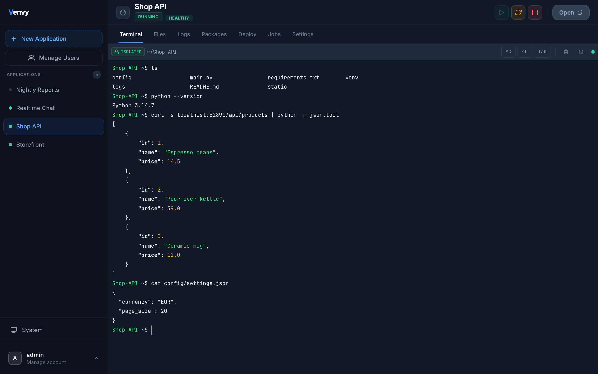
</p>

## Install

On a fresh Debian 12+ or Ubuntu 22.04+ machine:

```bash
curl -fsSL https://github.com/nikolaus018/venvy/releases/latest/download/install.sh | sudo bash
```

That installs the system packages it needs, sets up a systemd service that starts at boot (with
one Unix user per hosted app, see [Isolation](#isolation)), and prints the URL and a one-time setup code. The first visit creates the admin account, with that code
(it is also in the server log and in `.setup-code` in the data directory).

Rather not pipe a script into `sudo bash` unseen? [SECURITY.md](SECURITY.md#checking-a-release-yourself)
shows how to check a release's signature and read the installer before running it.

Run the same command again to update. The new version is downloaded, checked against its
checksum and its signature (see [Releases](#releases)) and prepared next to the running one; the database is snapshotted; and if the new version does not
come up healthy, the installer switches back on its own.

Once installed, an admin can also update from the UI: System shows the running version and,
when a newer release is out, an Update button that runs the same steps on the server.

Options go after `bash -s --`:

```bash
curl -fsSL https://github.com/nikolaus018/venvy/releases/latest/download/install.sh \
  | sudo bash -s -- --host 127.0.0.1 --port 8080
```

| Option | Meaning |
|---|---|
| `--host ADDR` | Address to bind. Default `0.0.0.0`; use `127.0.0.1` to be reachable only through a Cloudflare tunnel. |
| `--port N` | Port. Default `54783`. |
| `--version TAG` | Install a specific release instead of the latest. |
| `--with-rust` | Also install `cargo`/`rustc` so Rust apps can be hosted. |
| `--with-node` | Also install `nodejs`/`npm` so Node.js apps can be hosted. |
| `--with-go` | Also install Go (the current release from go.dev, checksum-verified). |
| `--with-bun` / `--with-deno` | Also install Bun / Deno (the official release, checksum-verified). |
| `--with-php` | Also install `php-cli` and Composer. |
| `--with-ruby` | Also install Ruby and Bundler. |
| `--with-java` | Also install a headless Java runtime. |
| `--with-all` | All of the above, and Rust. Python and static sites need nothing extra. |
| `--shared-user` | Run every app as the one `venvy` user instead of one Unix user per app (see [Isolation](#isolation)). |
| `--uninstall` | Remove the service and code. Data and config are kept. |

Settings live in `/etc/venvy/venvy.env`, data in `/var/lib/venvy`, code in `/opt/venvy`.

## Runtimes

Pick one when you create an app; it can be changed later in Settings. Venvy tells you at start-up
(and in the dropdown) which ones this host is missing.

| Runtime | Starts with | Packages tab |
|---|---|---|
| Python | the entrypoint, in its own virtualenv | pip |
| Node.js | `node <entrypoint>`, or `npm start` if blank | npm |
| Bun | `bun run <entrypoint>`, or the `start` script if blank | `bun add` / `bun remove` |
| Deno | `deno run --allow-all <entrypoint>`, or `deno task start` | `deno add` / `deno remove` |
| Go | `go run .` | `go get` / `go mod` |
| Rust | `cargo run` | listed from `Cargo.toml` |
| PHP | PHP's built-in server on the app folder (or `public/`), or your router script | Composer |
| Ruby | `ruby <entrypoint>`, `rackup` for a `config.ru`; `bundle exec` with a Gemfile | Bundler |
| Java | `java -jar <entrypoint>` | – |
| Static site | a small file server on a folder (`public`, `dist`, `build`, … or the one you name) | – |

Dependencies are installed when the app is created if its manifest is uploaded with it, and
otherwise on the first start (or with "Install from manifest" in the Packages tab).

## What it does

- **Apps as first-class things.** Create an app, upload a folder (chunked, resumable), and Venvy
  builds its virtualenv and installs `requirements.txt`. Start, stop and restart from the UI.
- **Deploy from git.** Point an app at a repository and a build command; one click (or a push
  webhook from GitHub, GitLab, Gitea or Forgejo) pulls, installs dependencies, builds, restarts and
  checks the app came up — and puts the previous version back if it did not. Every deploy is a
  release you can roll back to; apps without git get file snapshots.
- **Watching.** Health checks (with restarts), CPU / memory / disk history, resource alerts, and
  notifications by webhook, Slack, Discord, ntfy, Telegram or email when something crashes, fails to
  deploy, or goes over a limit.
- **Scheduled jobs.** Cron-style commands per app, run as the app's own user.
- **Automatic backups** on a schedule, with retention and an off-site copy (S3-compatible, WebDAV or scp).
- **Own domains.** An app with a domain is served for that hostname on Venvy's port, WebSockets included.
- **Access.** API tokens for CI, users limited to chosen apps, an audit trail, variables shared by every app.
- **Supervision.** Restart policies (`never`, `on-failure`, `always`) with crash-loop back-off,
  start-on-boot, port detection, and per-app CPU and memory limits through systemd scopes.
- **A real terminal in the browser.** A PTY shell in the app's directory with its virtualenv
  active, including a key bar for phones.
- **Files.** Tree, editor (Ace), upload, download, rename, copy, drag and drop.
- **Logs.** Live tail with ANSI colours, filtering, follow and wrap, rotation on the server.
- **Packages.** List, install and remove; a scanner that finds imports missing from the venv.
- **Public URLs.** Publish an app on your own domain through a Cloudflare Tunnel; Venvy manages
  the tunnel ingress rule and the DNS record.
- **Backups.** One archive holds the database, the encryption key and every app. Restore rolls
  the live server back in place, after taking a safety backup first — from a backup on the
  server or one you upload. Both show step-by-step progress that is kept on the server, so it
  is still there after closing the browser.
- **Users and roles.** Admin, operator and read-only viewer, with optional TOTP two-factor.
- **Installable PWA** with light and dark themes, a command palette (<kbd>Ctrl</kbd>+<kbd>K</kbd>)
  and keyboard shortcuts.

<table>
  <tr>
    <td>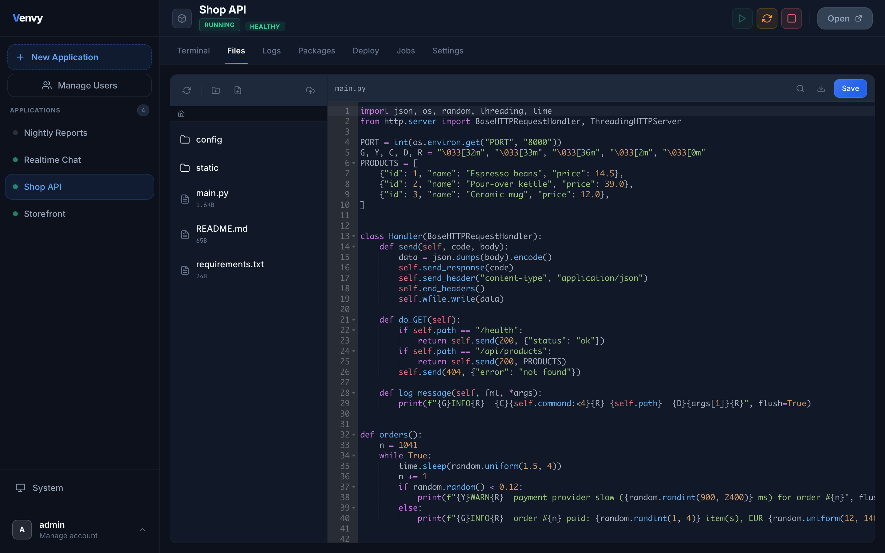<br><sub>Files and editor</sub></td>
    <td>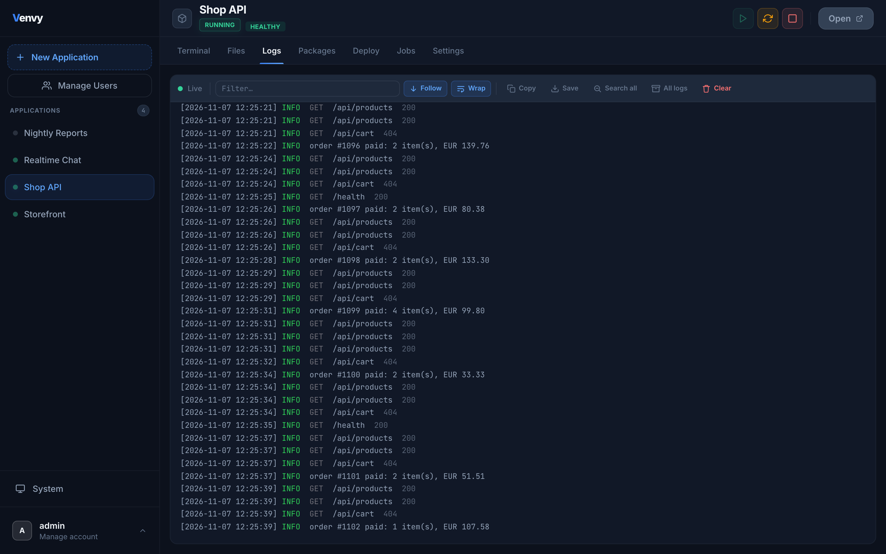<br><sub>Live logs, with search across rotated files</sub></td>
  </tr>
  <tr>
    <td>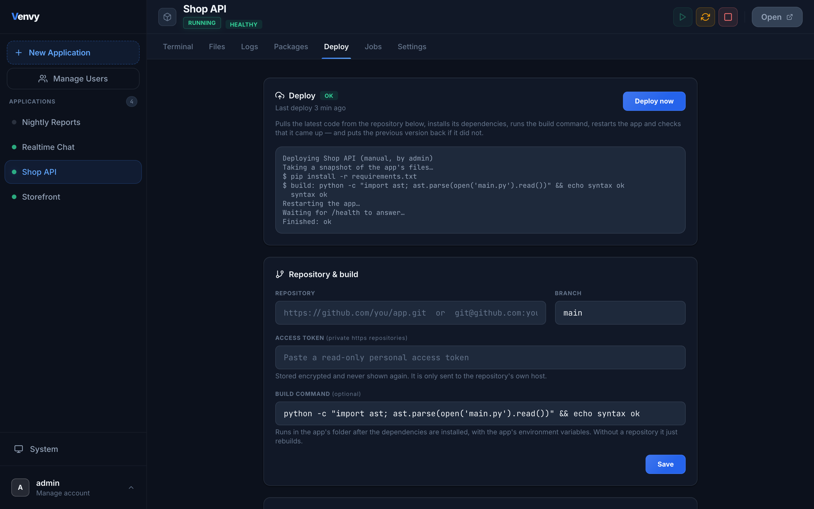<br><sub>Deploys, with automatic rollback</sub></td>
    <td>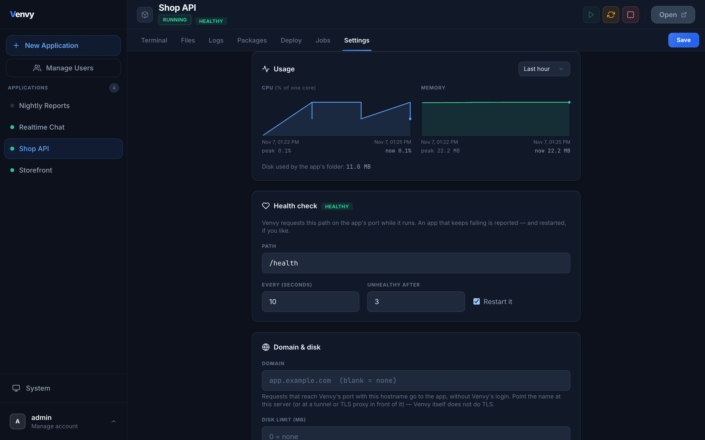<br><sub>Usage history and health checks</sub></td>
  </tr>
  <tr>
    <td>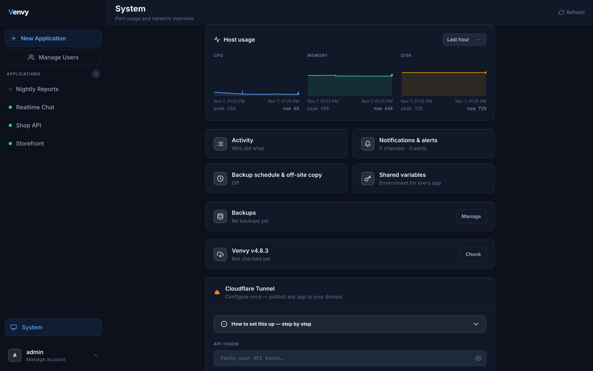<br><sub>System: host usage, activity, alerts, backups, updates</sub></td>
    <td>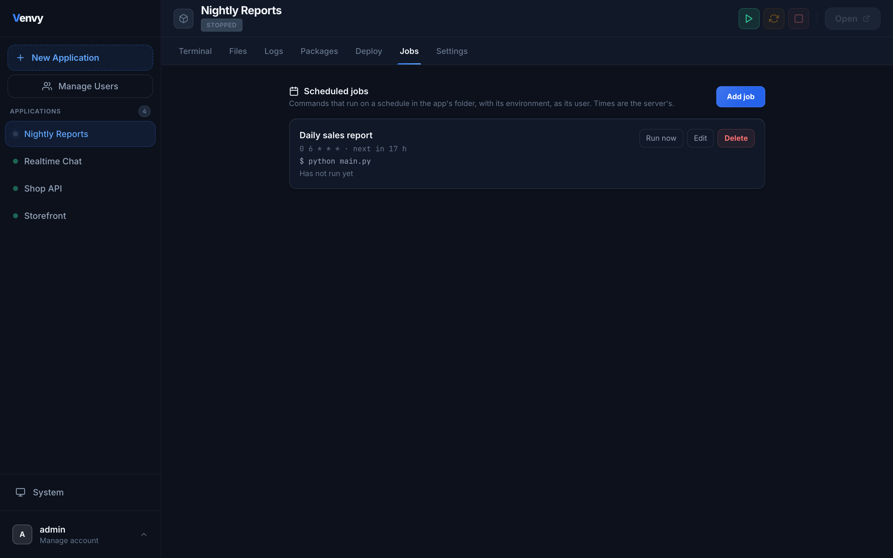<br><sub>Scheduled jobs</sub></td>
  </tr>
  <tr>
    <td>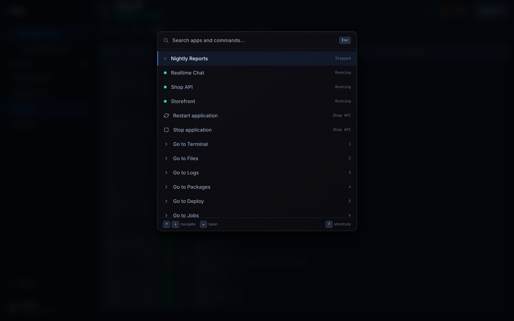<br><sub>Command palette (<kbd>Ctrl</kbd>+<kbd>K</kbd>)</sub></td>
    <td>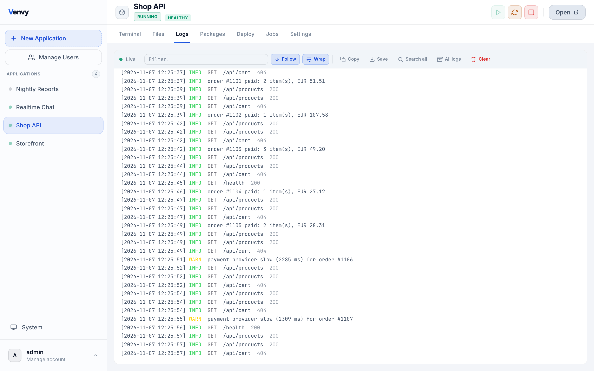<br><sub>Light theme</sub></td>
  </tr>
</table>

<p align="center">
  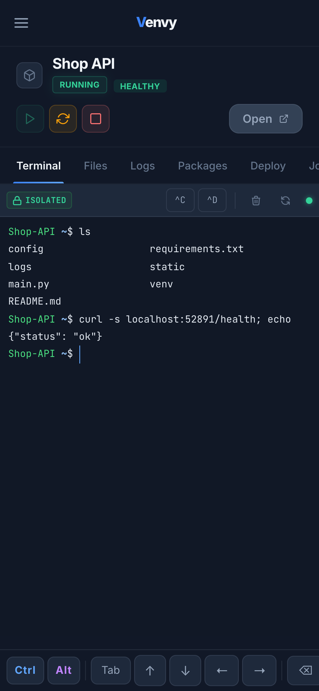
  &nbsp;
  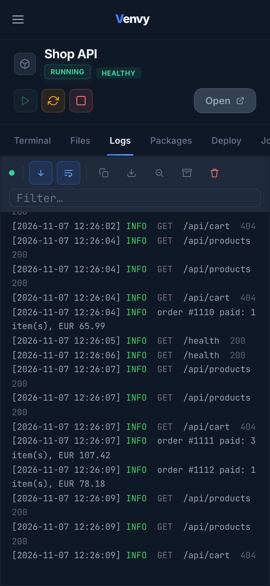
  &nbsp;
  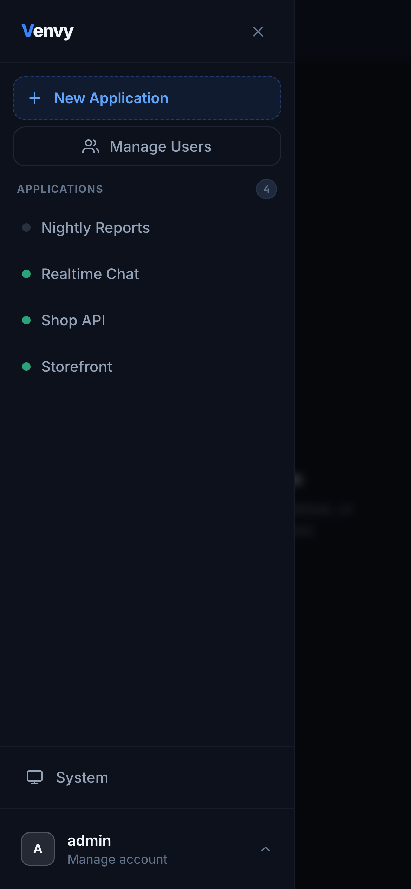
</p>

## How it is built

A FastAPI backend with SQLite, and a framework-free frontend. No build step anywhere: the
server runs from source, and the browser loads plain scripts.

```
main.py            entry point
venvy/             backend package
  config  crypto  models  db  auth       settings, encryption, tables, sessions and roles
  safefs  isolation                      symlink-safe file access, per-app Unix users
  process  terminal  backup              lifecycle and supervisor, PTY terminal, backup/restore
  runtimes  deploy  scheduler  monitor   the ten runtimes, git deploys, cron jobs, health and alerts
  cloudflare  proxy  notify              tunnel routes, app domains, notifications
  api/                                   one router per resource
  app                                    FastAPI app: lifespan, middleware, static routes
web/
  index.html  partials/                  page skeleton and per-view markup, assembled server-side
  static/css  static/js                  styles; one script per feature
docs/              API reference (API.md) and the screenshots
scripts/           release signing, Tailwind build, UI emulator, screenshot retake
tests/             end-to-end suite
install.sh         installer and updater
```

A few decisions worth pointing out:

- **Two secrets per session.** Browsers send cookies to every port on a host, including the
  hosted apps. So the session cookie alone is not enough: each request also carries a
  per-session key from `localStorage`, which is scoped to Venvy's own origin.
- **Secrets encrypted at rest.** App environment variables, the Cloudflare token
  and TOTP secrets are Fernet-encrypted with a key that never leaves the host and is never
  returned by the API.
- **No path is trusted twice.** File operations resolve a request path once, then walk it from
  the app directory one component at a time with `O_NOFOLLOW` and work relative to the
  resulting directory descriptor, so a directory swapped for a symlink mid-request is refused
  rather than followed.
- **One lock per app.** Start, stop and restart are serialised per app, and the supervisor
  re-reads state under that lock, so a double click or a restart racing a crash cannot leave
  an untracked process behind.
- **Restore without swapping files under a live database.** The backup's snapshot is loaded
  into the running SQLite file through its backup API, then the process re-executes itself.

The API is documented in [docs/API.md](docs/API.md).

### Isolation

Each hosted app gets its own locked Unix user that owns only its directory; its process,
terminal and package installs run as that user, so an app can't read Venvy's database, the key
that decrypts every app's secrets, or another app. For that, the Venvy service runs as root.

`--shared-user` runs everything as one `venvy` user instead: apps are kept away from the rest of
the system, but not from each other or from Venvy's own data, and an operator's terminal can read
the database. An existing install keeps the mode it was installed with; switch with
`--app-users` or `--shared-user` (or `VENVY_APP_USERS` in `/etc/venvy/venvy.env`).

Apps share the host's network. They can reach Venvy on its port like anyone else, but can't pass
for another client there: a connection from loopback is only taken to be cloudflared's (and its
`CF-Connecting-IP` believed) when no hosted app owns it. Other software on the host can still
claim any address; `VENVY_PROXY_SECRET` closes that too.

### Security

What Venvy protects against, what it deliberately doesn't (admins and operators are trusted with
the apps they manage; it is not a container sandbox), how to verify a release yourself and how
the protections are tested is in [SECURITY.md](SECURITY.md). Found a problem? Please
[report it privately](https://github.com/nikolaus018/venvy/security/advisories/new).

### Locked out?

If the only admin forgets the password or loses the authenticator, fix the account from a shell
on the server — it works whether or not Venvy is running, and signs that user out everywhere:

```bash
cd /var/lib/venvy
sudo /opt/venvy/current/.venv/bin/python /opt/venvy/current/main.py --reset-password admin
sudo /opt/venvy/current/.venv/bin/python /opt/venvy/current/main.py --disable-2fa admin
```

(With `--shared-user` the service runs as `venvy`: use `sudo -u venvy` instead.)

## Development

```bash
python3 -m venv .venv && . .venv/bin/activate
pip install -r requirements.txt
python main.py                 # serves http://127.0.0.1:54783, data in the current directory
```

To work on the UI without a real backend, `python scripts/emulator.py` serves the same `web/` tree
against fake data. After a change to the UI, `python scripts/screenshots.py` retakes the
screenshots above from a real Venvy running demo apps (needs Playwright and Chrome).

### Tests

The suite boots a real server on a throwaway data directory and drives it over HTTP and
WebSocket: login and roles, files and uploads, the process lifecycle under concurrency,
backup, backup upload and in-place restore, the terminal, request limits and the races around
deleting an app or losing the server mid-run, and a Chrome pass over every view.

```bash
pip install -r tests/requirements.txt
tests/run_all.sh
```

### Releases

Pushing a `v*` tag runs the smoke test and puts `venvy.tar.gz`, its SHA-256 and `install.sh`
up as a draft GitHub release. It is published by `scripts/sign-release.sh <tag>`, run on the
maintainer's machine: it unpacks the archive, checks it is the tag file for file, signs the
checksum with an Ed25519 key that is never on GitHub, uploads the signature and publishes.
The installer and the updater install nothing whose signature doesn't match the key in
`install.sh` (the updater: the key the server was installed with), so someone who got into the
GitHub account could not ship an update. The first `curl | sudo bash` still trusts what it
downloads, as any such install does.

CI runs on every push: the full suite on Ubuntu, and the installer itself on a real host in
both modes — fresh install, checks against the running service, update, automatic rollback of
a release that does not start, rejection of a bad checksum and of a signature by another key
(by the installer and by the updater), and uninstall. Also on every push: the smoke test on
Python 3.10 (the oldest supported), CodeQL over the backend, the UI's JavaScript and the
workflows, and `pip-audit` against the pinned dependencies; Dependabot keeps those and the
(commit-pinned) actions current.

## Status

Venvy is a personal project that I run on my own servers, maintained by one person and not
independently audited (see [SECURITY.md](SECURITY.md#status)). Everything described above is
covered by the automated suite, including per-app-user mode and systemd resource limits, which
CI exercises as root on a real Ubuntu host. Debian 12+ and Ubuntu 22.04+ are the supported
targets; a frozen single-binary build is not.

## License

[MIT](LICENSE). The bundled Tailwind CSS (`web/static/css/tailwind.css`) is MIT-licensed by
Tailwind Labs ([tailwind.LICENSE](web/static/css/tailwind.LICENSE)).
