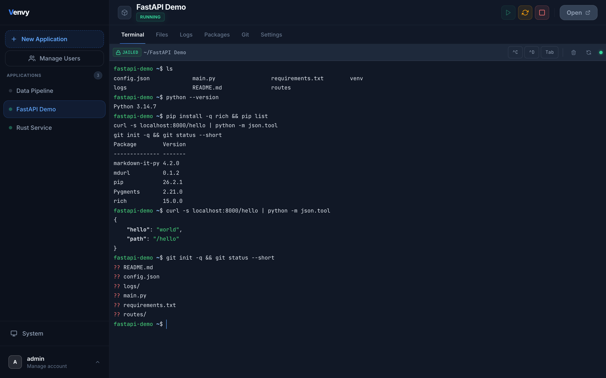
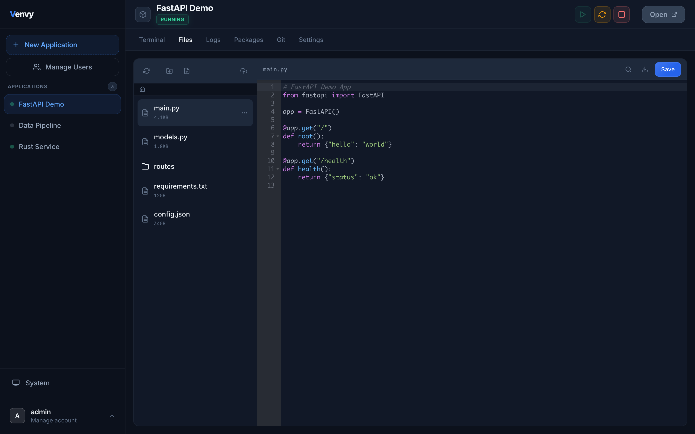
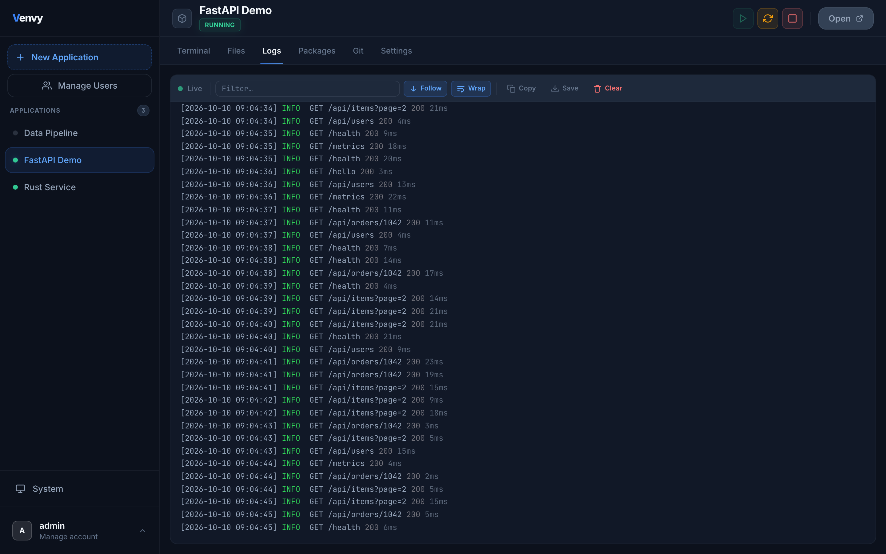
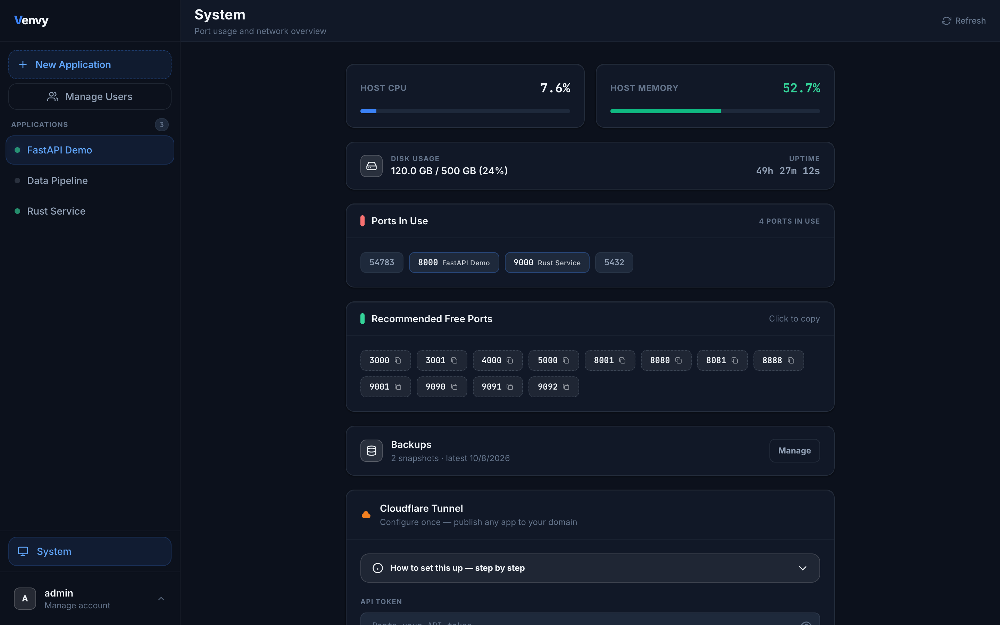
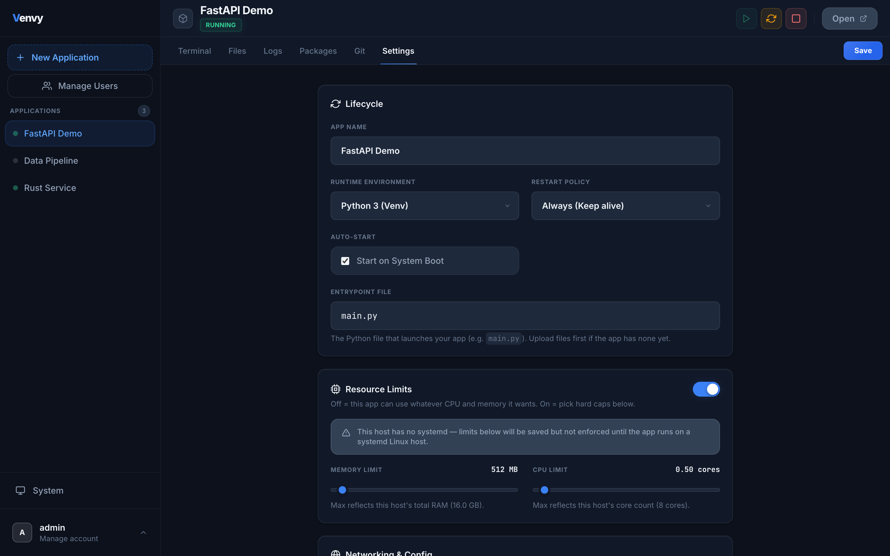
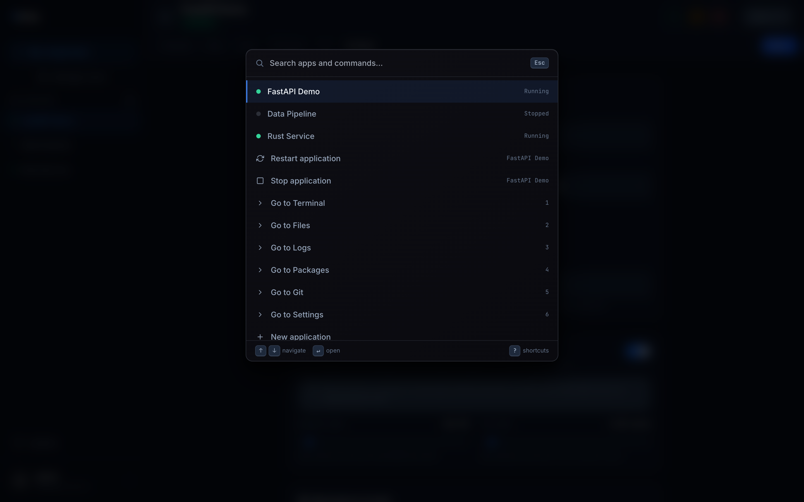
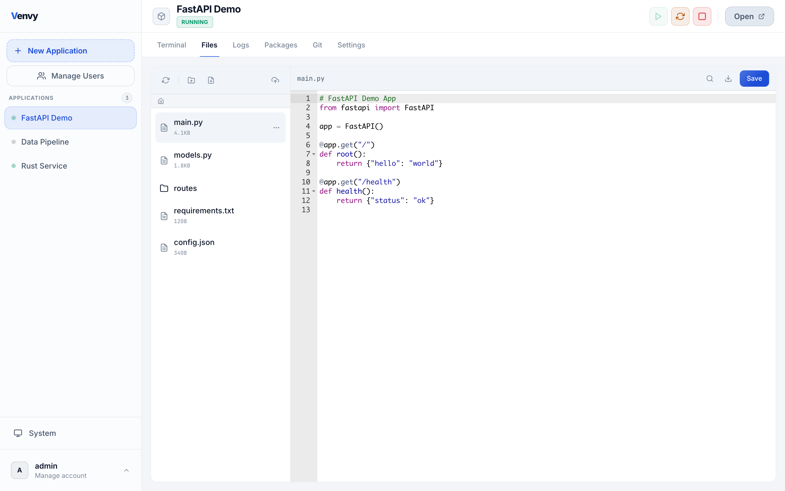
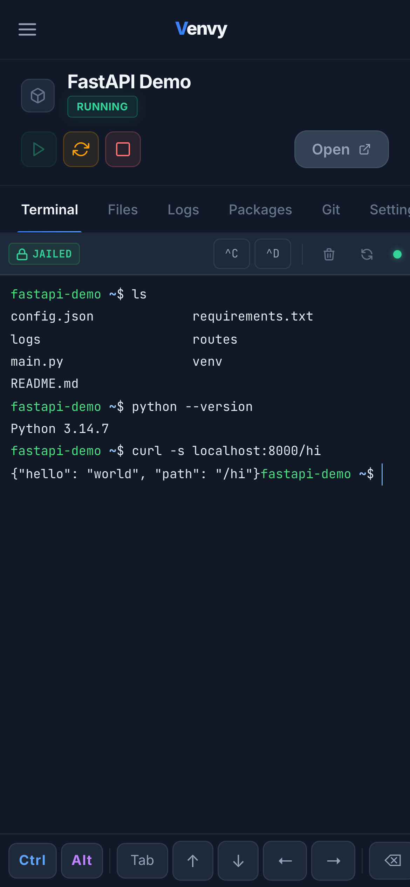
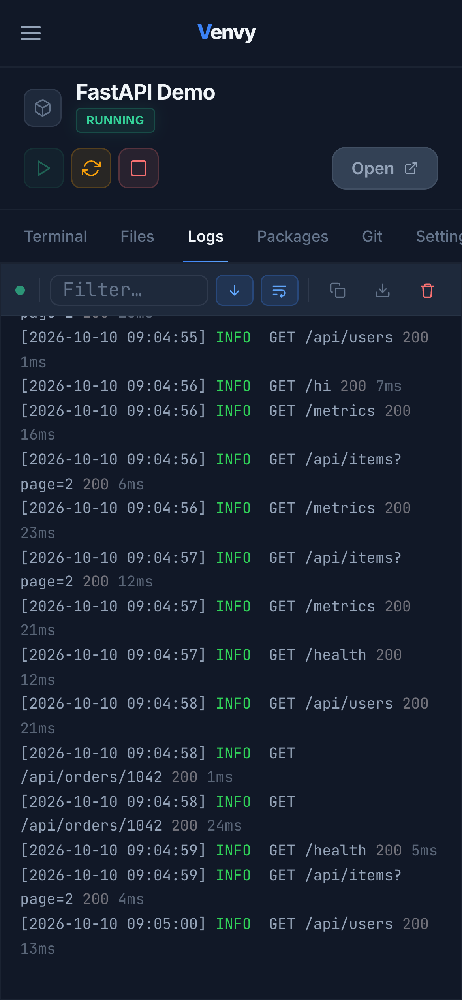
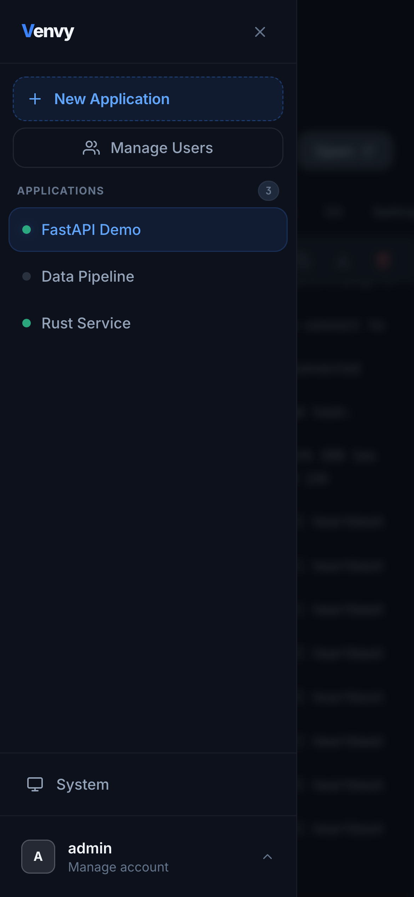

<h1 align="center">Venvy</h1>

<p align="center">
  <b>A self-hosted control panel for running your apps on one server — Python, Node.js, Bun, Deno, Go, Rust, PHP, Ruby, Java and static sites.</b><br>
  Upload code, get a virtualenv, a process supervisor, a browser terminal, live logs and a public URL.
</p>

<p align="center">
  <a href="https://github.com/nikolaus018/venvy/actions/workflows/ci.yml"></a>
  <a href="https://github.com/nikolaus018/venvy/releases/latest"></a>
  <a href="LICENSE"></a>
</p>

<p align="center">
  
</p>

## Install

On a fresh Debian 12+ or Ubuntu 22.04+ machine:

```bash
curl -fsSL https://github.com/nikolaus018/venvy/releases/latest/download/install.sh | sudo bash
```

That installs the system packages it needs, creates a `venvy` service user, sets up a systemd
service that starts at boot, and prints the URL. The first visit creates the admin account.

Run the same command again to update. The new version is downloaded, checksum-verified and
prepared next to the running one; the database is snapshotted; and if the new version does not
come up healthy, the installer switches back on its own.

Once installed, an admin can also update from the UI: System shows the running version and,
when a newer release is out, an Update button that runs the same steps on the server.

Options go after `bash -s --`:

```bash
curl -fsSL https://github.com/nikolaus018/venvy/releases/latest/download/install.sh \
  | sudo bash -s -- --host 127.0.0.1 --port 8080
```

| Option | Meaning |
|---|---|
| `--host ADDR` | Address to bind. Default `0.0.0.0`; use `127.0.0.1` to be reachable only through a Cloudflare tunnel. |
| `--port N` | Port. Default `54783`. |
| `--version TAG` | Install a specific release instead of the latest. |
| `--with-rust` | Also install `cargo`/`rustc` so Rust apps can be hosted. |
| `--with-node` | Also install `nodejs`/`npm` so Node.js apps can be hosted. |
| `--with-go` | Also install Go (the current release from go.dev, checksum-verified). |
| `--with-bun` / `--with-deno` | Also install Bun / Deno (the official release, checksum-verified). |
| `--with-php` | Also install `php-cli` and Composer. |
| `--with-ruby` | Also install Ruby and Bundler. |
| `--with-java` | Also install a headless Java runtime. |
| `--with-all` | All of the above, and Rust. Python and static sites need nothing extra. |
| `--app-users` | Run as root with one Unix user per hosted app (see [Isolation](#isolation)). |
| `--uninstall` | Remove the service and code. Data and config are kept. |

Settings live in `/etc/venvy/venvy.env`, data in `/var/lib/venvy`, code in `/opt/venvy`.

## Runtimes

Pick one when you create an app; it can be changed later in Settings. Venvy tells you at start-up
(and in the dropdown) which ones this host is missing.

| Runtime | Starts with | Packages tab |
|---|---|---|
| Python | the entrypoint, in its own virtualenv | pip |
| Node.js | `node <entrypoint>`, or `npm start` if blank | npm |
| Bun | `bun run <entrypoint>`, or the `start` script if blank | `bun add` / `bun remove` |
| Deno | `deno run --allow-all <entrypoint>`, or `deno task start` | `deno add` / `deno remove` |
| Go | `go run .` | `go get` / `go mod` |
| Rust | `cargo run` | listed from `Cargo.toml` |
| PHP | PHP's built-in server on the app folder (or `public/`), or your router script | Composer |
| Ruby | `ruby <entrypoint>`, `rackup` for a `config.ru`; `bundle exec` with a Gemfile | Bundler |
| Java | `java -jar <entrypoint>` | – |
| Static site | a small file server on a folder (`public`, `dist`, `build`, … or the one you name) | – |

Dependencies are installed when the app is created if its manifest is uploaded with it, and
otherwise on the first start (or with "Install from manifest" in the Packages tab).

## What it does

- **Apps as first-class things.** Create an app, upload a folder (chunked, resumable), and Venvy
  builds its virtualenv and installs `requirements.txt`. Start, stop and restart from the UI.
- **Deploy from git.** Point an app at a repository and a build command; one click (or a push
  webhook from GitHub, GitLab, Gitea or Forgejo) pulls, installs dependencies, builds, restarts and
  checks the app came up — and puts the previous version back if it did not. Every deploy is a
  release you can roll back to; apps without git get file snapshots.
- **Watching.** Health checks (with restarts), CPU / memory / disk history, resource alerts, and
  notifications by webhook, Slack, Discord, ntfy, Telegram or email when something crashes, fails to
  deploy, or goes over a limit.
- **Scheduled jobs.** Cron-style commands per app, run as the app's own user.
- **Automatic backups** on a schedule, with retention and an off-site copy (S3-compatible, WebDAV or scp).
- **Own domains.** An app with a domain is served for that hostname on Venvy's port, WebSockets included.
- **Access.** API tokens for CI, users limited to chosen apps, an audit trail, variables shared by every app.
- **Supervision.** Restart policies (`never`, `on-failure`, `always`) with crash-loop back-off,
  start-on-boot, port detection, and per-app CPU and memory limits through systemd scopes.
- **A real terminal in the browser.** A PTY shell in the app's directory with its virtualenv
  active, including a key bar for phones.
- **Files.** Tree, editor (Ace), upload, download, rename, copy, drag and drop.
- **Logs.** Live tail with ANSI colours, filtering, follow and wrap, rotation on the server.
- **Packages.** List, install and remove; a scanner that finds imports missing from the venv.
- **Public URLs.** Publish an app on your own domain through a Cloudflare Tunnel; Venvy manages
  the tunnel ingress rule and the DNS record.
- **Backups.** One archive holds the database, the encryption key and every app. Restore rolls
  the live server back in place, after taking a safety backup first — from a backup on the
  server or one you upload. Both show step-by-step progress that is kept on the server, so it
  is still there after closing the browser.
- **Users and roles.** Admin, operator and read-only viewer, with optional TOTP two-factor.
- **Installable PWA** with light and dark themes, a command palette (<kbd>Ctrl</kbd>+<kbd>K</kbd>)
  and keyboard shortcuts.

<table>
  <tr>
    <td></td>
    <td></td>
  </tr>
  <tr>
    <td></td>
    <td></td>
  </tr>
  <tr>
    <td></td>
    <td></td>
  </tr>
</table>

<p align="center">
  
  &nbsp;
  
  &nbsp;
  
</p>

## How it is built

A FastAPI backend with SQLite, and a framework-free frontend. No build step anywhere: the
server runs from source, and the browser loads plain scripts.

```
main.py            entry point
venvy/             backend package
  config  crypto  models  db  auth       settings, encryption, tables, sessions and roles
  safefs  isolation                      symlink-safe file access, per-app Unix users
  process  terminal  backup              lifecycle and supervisor, PTY terminal, backup/restore
  cloudflare  settings  jobs             integrations, setting rules, background jobs
  api/                                   one router per resource
  app                                    FastAPI app: lifespan, middleware, static routes
web/
  index.html  partials/                  page skeleton and per-view markup, assembled server-side
  static/css  static/js                  styles; one script per feature
tests/             end-to-end suite
install.sh         installer and updater
```

A few decisions worth pointing out:

- **Two secrets per session.** Browsers send cookies to every port on a host, including the
  hosted apps. So the session cookie alone is not enough: each request also carries a
  per-session key from `localStorage`, which is scoped to Venvy's own origin.
- **Secrets encrypted at rest.** App environment variables, the Cloudflare token
  and TOTP secrets are Fernet-encrypted with a key that never leaves the host and is never
  returned by the API.
- **No path is trusted twice.** File operations resolve a request path once, then walk it from
  the app directory one component at a time with `O_NOFOLLOW` and work relative to the
  resulting directory descriptor, so a directory swapped for a symlink mid-request is refused
  rather than followed.
- **One lock per app.** Start, stop and restart are serialised per app, and the supervisor
  re-reads state under that lock, so a double click or a restart racing a crash cannot leave
  an untracked process behind.
- **Restore without swapping files under a live database.** The backup's snapshot is loaded
  into the running SQLite file through its backup API, then the process re-executes itself.

The API is documented in [venvy-api-documentation.md](venvy-api-documentation.md).

### Isolation

By default every hosted app runs as the same `venvy` user. That keeps apps away from the rest
of the system, but not from each other or from Venvy's own data. Installing with `--app-users`
runs Venvy as root and gives each app its own locked Unix user that owns only its directory;
its process, terminal and package installs run as that user.

### Locked out?

If the only admin forgets the password or loses the authenticator, fix the account from a shell
on the server — it works whether or not Venvy is running, and signs that user out everywhere:

```bash
cd /var/lib/venvy
sudo -u venvy /opt/venvy/current/.venv/bin/python /opt/venvy/current/main.py --reset-password admin
sudo -u venvy /opt/venvy/current/.venv/bin/python /opt/venvy/current/main.py --disable-2fa admin
```

(With `--app-users` the service runs as root: leave out `-u venvy`.)

## Development

```bash
python3 -m venv .venv && . .venv/bin/activate
pip install -r requirements.txt
python main.py                 # serves http://127.0.0.1:54783, data in the current directory
```

To work on the UI without a real backend, `python emulator.py` serves the same `web/` tree
against fake data.

### Tests

The suite boots a real server on a throwaway data directory and drives it over HTTP and
WebSocket: login and roles, files and uploads, the process lifecycle under concurrency,
backup, backup upload and in-place restore, the terminal, request limits and the races around
deleting an app or losing the server mid-run, and a Chrome pass over every view.

```bash
pip install -r tests/requirements.txt
tests/run_all.sh
```

### Releases

Pushing a `v*` tag runs the smoke test and publishes `venvy.tar.gz`, its SHA-256 and
`install.sh` as a GitHub release, which is what the install command downloads.

CI runs on every push: the full suite on Ubuntu, and the installer itself on a real host in
both modes — fresh install, checks against the running service, update, automatic rollback of
a release that does not start, rejection of a bad checksum, and uninstall.

## Status

Venvy is a personal project that I run on my own servers. Everything described above is
covered by the automated suite, including per-app-user mode and systemd resource limits, which
CI exercises as root on a real Ubuntu host. Debian 12+ and Ubuntu 22.04+ are the supported
targets; a frozen single-binary build is not.

## License

[MIT](LICENSE)
